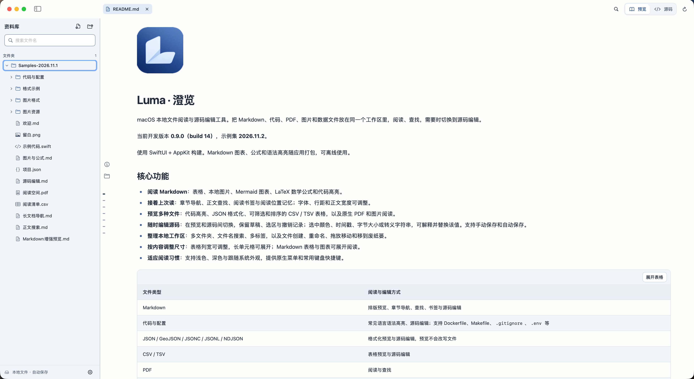
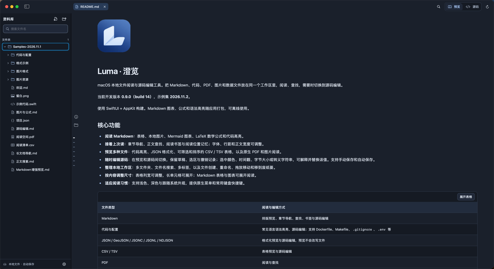

# Luma

English · [简体中文](README.zh-CN.md)

A local file reader and source editor for macOS. Read Markdown, code, PDFs, images and data in one workspace, search what you need, and switch to source when you want to edit.

Current development version: **0.9.0 (build 16)**. Sample collection: **2026.11.3**.

Built with SwiftUI and AppKit. Markdown diagrams, math and syntax highlighting ship with the app and work offline.

## Screenshots

Markdown reading in light appearance:



The same workspace in dark appearance:



Screenshots show the Chinese interface; English is the default for new installations.

## Features

- **Read Markdown:** tables, local images, Mermaid diagrams, LaTeX math and highlighted code.
- **Pick up where you left off:** heading navigation, Find, bookmarks and saved reading positions, with adjustable typography and text width.
- **Preview different formats:** highlighted code, formatted JSON, filterable and sortable CSV / TSV, and native PDF and image readers.
- **Edit the source:** keep drafts, selections and undo history while switching modes. Inspect selected colors, timestamps, byte sizes and escaped strings, then explicitly replace them. Save manually or enable Auto Save.
- **Organize local files:** multiple folders, filename search, tabs, file creation, renaming, drag-and-drop moves and Move to Trash.
- **Fit the content:** resize table columns, open long cells, and expand Markdown tables and diagrams.
- **Make it yours:** English and Simplified Chinese, system / light / dark appearance, native menus and keyboard shortcuts.

| File type | Reading and editing |
| --- | --- |
| Markdown | Formatted preview, headings, Find, bookmarks and source editing |
| Code and configuration | Highlighted preview and source editing, including Dockerfile, Makefile, `.gitignore` and `.env` |
| JSON / GeoJSON / JSONC / JSONL / NDJSON | Formatted preview and source editing; preview never rewrites files |
| CSV / TSV | Table preview and source editing |
| PDF | Reading and Find |
| Images / SVG | Zoomable preview; SVG also supports source editing |
| Other UTF-8 text | Content-based detection, reading, Find and editing |

See the [User Guide](docs/USAGE.md) for details and shortcuts.

## Build from source

Requires **macOS 14+, Swift 6.2+ and Apple Command Line Tools**. Your installed Apple toolchain must provide a compatible Swift version. There are no remote SwiftPM dependencies or npm installation steps.

From the repository root, build an app you can open in Finder:

```sh
zsh scripts/build-app.sh release
open dist/Luma.app
```

Or run directly:

```sh
swift run Luma
```

Builds use local ad hoc signing. They are not Developer ID signed or notarized by Apple.

## Get started

1. Choose **Open Sample Workspace** to try real document, code, image and data files in a local editable copy.
2. Press `⌘O` to open files, `⇧⌘O` to add a folder, or drag files and folders into the window.
3. Use `⌘F` to search, `⌘S` to save to the original file, and `⌘,` to adjust appearance, reading and editing settings.

## Languages and samples

English is the default. Choose **Settings → Appearance → Language** to switch to **简体中文** or **English**. The interface updates immediately and remembers your choice. Existing language preferences are retained.

Both languages have a complete sample workspace, including translated filenames, guides, code comments, data and PDFs. **Open Sample Workspace** opens the collection for the current interface language. Each language and edition has a separate editable copy; reopening adds missing files and keeps your edits. Switching languages does not translate or replace open documents, filenames, drafts or reading positions.

App menus, buttons, messages and preview controls follow this setting. Some macOS system panels may follow the system language or update after restarting the app.

## Known limitations

- **Auto Save is off by default. Unsaved edits live in memory; crash recovery is not available.** Closing files or quitting prompts you to handle unsaved changes.
- UTF-8 text reads and saves are limited to 4 MB; PDFs to 128 MB; bitmap images to 64 MB. CSV / TSV previews accept up to 10,000 rows and 200 columns. See [reading and rendering limits](docs/DEVELOPMENT.md#reading-and-rendering-limits).
- Source mode is a plain text editor. PDFs and bitmap images are read-only; GIF displays its first frame.
- Raw HTML in Markdown is displayed as text. Remote images do not load automatically. Local image paths are restricted to the workspace scope; add a common parent folder when images live above the document.
- Search currently covers filenames and the active document, with no workspace-wide content search or continuous file watching. External changes are checked when activating Luma, switching tabs or refreshing.

## Project documentation

- [User Guide](docs/USAGE.md): workflows, shortcuts and examples.
- [Development Guide](docs/DEVELOPMENT.md): structure, building, tests, resources and rendering limits.
- [Changelog](CHANGELOG.md): development milestones and historical validation.
- [Contributing](CONTRIBUTING.md): issues, suggestions and patches.

Use the repository's Bug Report or Feature Request issue templates. [CI](.github/workflows/ci.yml) runs tests and builds on pushes, pull requests and manual dispatch.

## License

Luma uses the [MIT License](LICENSE). Bundled third-party Markdown components retain their own [licenses and notices](Sources/Luma/Resources/Markdown/THIRD_PARTY_NOTICES.txt).
