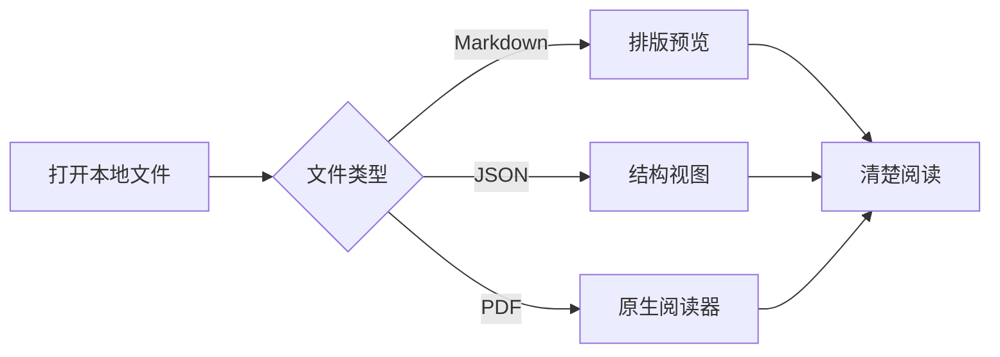
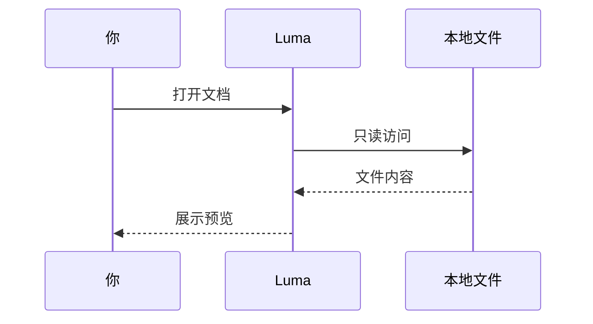

# Markdown，让内容更清楚

这份示例可以体验 **表格、Mermaid、代码高亮与图表展开**。所需引擎随应用打包，断网也可以阅读。

## 先体验展开阅读

- 点击表格上的「展开表格」，让宽表格使用更大的阅读区域。双击单元格或聚焦后按 Return，可查看完整单元格。
- 点击流程图上的「展开图表」，用「适合窗口」查看全貌，再用「按文字大小」阅读标签，也可以放大或缩小。
- 按 Esc 或点击关闭回到正文；展开操作不会修改文件。

需要筛选和排序时，请打开[阅读清单.csv](阅读清单.csv)；下面的 Markdown 表格用于排版与展开阅读。

## 表格与列对齐

| 功能 | 状态 | 优先级 |
| :--- | :---: | ---: |
| **表格排版** | 已支持 | 1 |
| Mermaid 流程图 | 已支持 | 2 |
| `代码高亮` | 已支持 | 3 |
| 转义分隔符：a\|b | 可阅读 | 4 |
| 这是一段完整的单元格说明：在窄窗口里双击它，可以单独阅读较长内容，关闭后继续查看原来的表格。 | 可展开 | 5 |

宽表格可以横向滚动，单元格内支持行内强调、链接和代码。

## Mermaid 流程图



## Mermaid 时序图



## 长行代码

```text
这是一条故意写长的阅读说明：代码块保留原有的长行布局，宽度不够时可以横向滚动。复制代码得到的是原始内容，不会改写文件中的换行。https://example.com/documents/reading-layout/table-and-diagram/long-line-preview
```

## Swift

```swift
struct ReadingSpace {
    let name = "Luma"
    var documents: [String] = []

    func contains(_ name: String) -> Bool {
        // 让每天打开的文件触手可及
        documents.contains(name)
    }
}
```

## TypeScript

```typescript
interface Document {
  name: string;
  readOnly: boolean;
}

const document: Document = {
  name: "Markdown增强预览.md",
  readOnly: true,
};

console.log(document.name);
```

## Python 与 JSON

```python
from pathlib import Path

def read_document(path: Path) -> str:
    """Keep files local, keep reading simple."""
    return path.read_text(encoding="utf-8")
```

```json
{
  "name": "Luma",
  "offline": true,
  "features": ["table", "mermaid", "syntax highlighting"]
}
```

## 图表写错也不会丢失内容

下面故意放了一个错误的图表，应该显示错误提示并保留完整源码；后面的内容仍可正常阅读。

```mermaid
flowchart LR
    A --> [
```

**阅读继续。** 使用预览 / 源码切换，可以随时看到原始 Markdown。
