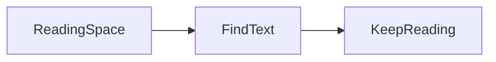

# Find content as you read

Press **Command-F** to open Find while staying in Preview. Matches appear in yellow; the current result is orange.

The bar shows the current result and total count. Use the arrows, Return / Shift-Return in the field, or Command-G / Shift-Command-G to move through matches and wrap around.

## Across inline formatting

Local **file** reading: the bold word does not interrupt a search phrase.

Here is the same phrase in plain text: local file reading.

[Jump to the reading log](#reading-log) to check that links still work while highlighted.

## Different characters and symbols

Search for an emoji 🙂 or accented text such as café. English matching ignores case: Hello, HELLO and hello match together.

Special characters are literal: `a+b? [x]` is not interpreted as a regular expression.

## Tables and code

| Location | Note |
| :--- | :--- |
| Local file reading | Table text is searchable |
| Café and English | Column alignment stays intact |

```swift
struct ReadingSpace {
    let title = "Local file reading"
    let staysLocal = true
}
```

Visible code is searchable without changing highlighting or Copy Code buttons.

## Math and diagrams

The visible text in $E=mc^2$ is searchable. Hidden accessibility MathML does not add duplicate matches.



Visible diagram labels are searchable. Collapsed diagram source stays out of results; expanding it makes that visible text searchable too.

## Reading log

Here is another instance of local file reading. Switching appearance retains your current match and position.

Search does not rewrite the document, links or equations, or replace your text selection.

## Clear and close

Try a phrase absent from the document to see **No Matches**. Clear the field, or press Esc in the Find bar, to remove highlighting.

Switch to Source to search the original Markdown. Your search phrase follows the mode switch.
