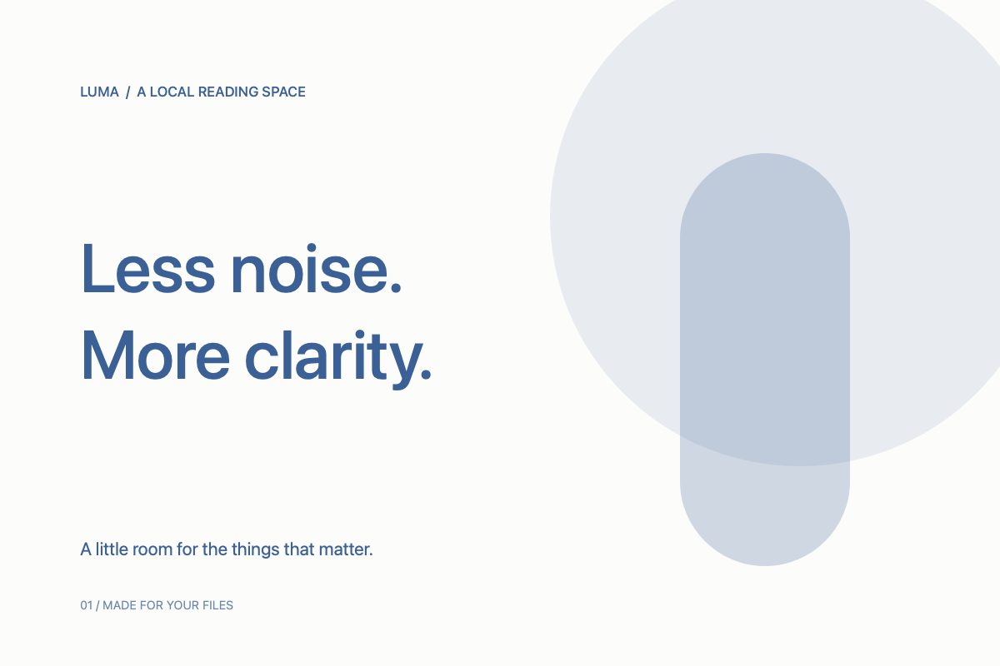

# Images and math on the same page

The images, math engine and fonts in this example are local and work offline.

## Local images

A PNG in this folder fits the reading width:

An SVG in a subfolder uses a filename with a space:

You can also [open it using a URL-encoded path](ImageAssets/Reading%20Flow.svg).

The [image format list](FormatExamples/FormatGuide.md#images) includes real JPEG, GIF, HEIC, TIFF, BMP, WebP and ICNS files.

## Inline math

Einstein's mass-energy relation is $E=mc^2$, and a circle's area is \(A=\pi r^2\).

Here `$x^2$` is code, and the amounts $5 and $10 remain ordinary text.

## Display math

The Gaussian integral:

$$
\int_{-\infty}^{+\infty} e^{-x^2}\,dx = \sqrt{\pi}
$$

Matrices and fractions:

\[
M = \begin{pmatrix} a & b \\ c & d \end{pmatrix},
\qquad M^{-1} = \frac{1}{ad-bc}\begin{pmatrix} d & -b \\ -c & a \end{pmatrix}
\]

## Math in tables

| Name | Formula |
| :--- | :--- |
| Pythagorean theorem | $a^2 + b^2 = c^2$ |
| Summation | $\sum_{i=1}^{n} i = \frac{n(n+1)}{2}$ |

## Errors do not interrupt reading

This intentionally missing image should display a path hint:

This intentionally unsupported command should preserve its source: $\notARealCommand{x}$.

**The following content remains readable.** Switch to Source to inspect the original paths and LaTeX.
