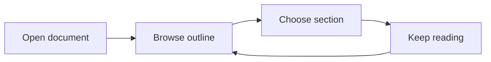

# A clear route through long documents

The short marks beside the text form a heading rail. Hover for a heading and excerpt, or click to jump. The active mark follows your current section as you scroll.

Try [jumping to the second reading log](#reading-log-1), or hover over a rail mark.

## Start with the outline

Each mark represents a heading. The rail stays beside the text, including in narrow windows.

Hover beside a heading to reveal its `#` link. It leads to the same position as the matching outline item. Jumps leave a little space above the heading.

### Expand and collapse

Right-click the rail and choose the hierarchical outline. Use the small arrows to collapse subsections, or the top menu to expand or collapse all sections.

Folding is retained in this tab. Visit another file and return without arranging the outline again.

#### Skipped levels still form a hierarchy

Documents sometimes jump from level two to level four. The outline indents headings according to their actual parent relationships.

###### A detail level

Level five is deliberately skipped here. Collapse “Skipped levels still form a hierarchy” to hide this detail.

## Stay in place after images load


Images change the page height. The outline updates heading positions after layout, and recalculates them when the window changes size.

Try jumping to a later section after resizing the window.

## Between math and diagrams

Equations, tables and diagrams work alongside the outline.

$$
\sum_{i=1}^{n} i = \frac{n(n+1)}{2}
$$



Inside a code block, `#` remains code and does not enter the outline:

```markdown
# This is sample code, not a document heading
## This line is also excluded from the outline
```

## Reading log

This is the first “Reading log”. Duplicate headings receive distinct anchors so each outline entry leads to the right place.

### First pass

Read the whole document once and note the purpose of each section. Use the outline to revisit a topic.

## Reading log

This is the second “Reading log”, with the anchor `#reading-log-1`. The opening link and its rail mark both lead here.

### Second pass

Scroll here, then change the appearance. Your position and heading navigation remain available.

Open Settings with Command-comma. Try a serif font, a larger size or wider line spacing under Markdown Reading. Layout updates immediately while preserving your paragraph where possible, and your choices survive restart.

## Return to the beginning

Click the first rail mark or [return to the title](#a-clear-route-through-long-documents).

## Bookmarks and reading position

Hover over a rail mark, move into its card and choose **Bookmark This Section**. Command-D bookmarks the current position.

The navigation card lists this document's bookmarks. Click one to return, or remove it when finished.

Your position is saved locally. Scroll up, close the document and reopen it from the file tree: you should return to your place. Restarting also restores document tabs and Markdown reading positions.

In Settings, try filling the reading area or choosing a custom maximum width. Layout changes try to keep the same paragraph visible.
