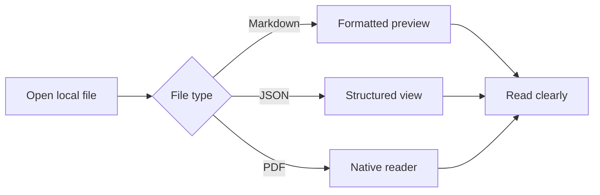
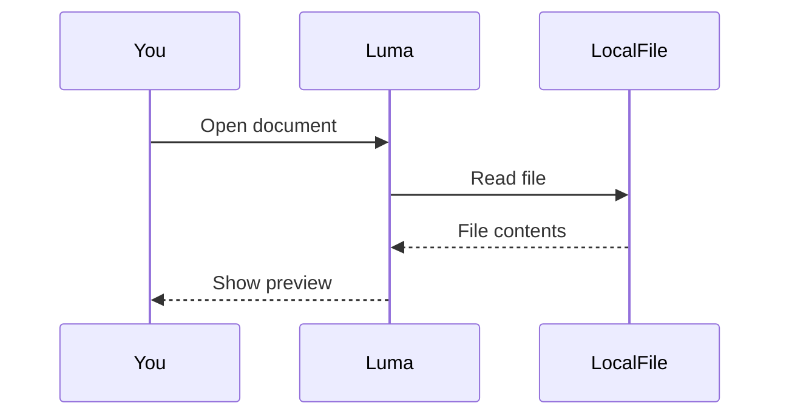

# Markdown brings content into focus

Try **tables, Mermaid, highlighted code and expanded diagrams**. Their engines ship with the app and work offline.

## Expand a table or diagram

- Choose **Expand Table** for a wider view. Double-click a cell, or focus it and press Return, to read all its content.
- Choose **Expand Diagram**, then **Fit to Window** for an overview or **Natural Text Size** for readable labels. Zoom in or out as needed.
- Press Esc or close the expanded view to return to your place. Expanding never changes the file.

For filtering and sorting, open [ReadingList.csv](ReadingList.csv). The Markdown table below demonstrates layout and expanded reading.

## Tables and column alignment

| Feature | Status | Priority |
| :--- | :---: | ---: |
| **Table layout** | Supported | 1 |
| Mermaid flowcharts | Supported | 2 |
| `Code highlighting` | Supported | 3 |
| Escaped separator: a\|b | Readable | 4 |
| This deliberately long cell can be opened on its own in a narrow window. Close it to return to the same table. | Expandable | 5 |

Wide tables scroll horizontally. Cells support inline emphasis, links and code.

## Mermaid flowchart



## Mermaid sequence diagram



## Long code lines

```text
This deliberately long line preserves its original layout. Scroll horizontally when the window is narrow. Copy Code returns the original content, without inserting new line breaks. https://example.com/documents/reading-layout/table-and-diagram/long-line-preview
```

## Swift

```swift
struct ReadingSpace {
    let name = "Luma"
    var documents: [String] = []

    func contains(_ name: String) -> Bool {
        // Keep everyday documents within reach.
        documents.contains(name)
    }
}
```

## TypeScript

```typescript
interface Document {
  name: string;
  readOnly: boolean;
}

const document: Document = {
  name: "MarkdownPreview.md",
  readOnly: true,
};
console.log(document.name);
```

## Python and JSON

```python
from pathlib import Path

def read_document(path: Path) -> str:
    """Keep files local, keep reading simple."""
    return path.read_text(encoding="utf-8")
```

```json
{
  "name": "Luma",
  "offline": true,
  "features": ["table", "mermaid", "syntax highlighting"]
}
```

## Errors leave the source available

This intentionally invalid diagram should display an error and preserve its complete source. The content after it remains readable.

```mermaid
flowchart LR
    A --> [
```

**Keep reading.** Switch to Source whenever you want to inspect the original Markdown.
