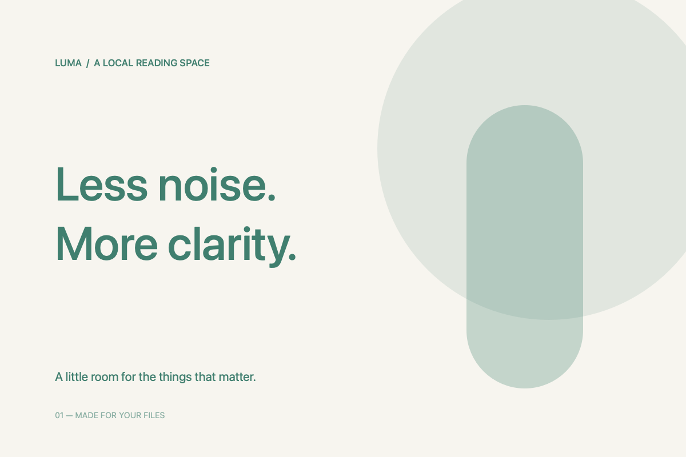

# 长文档，有一条清楚的路线

右侧的目录大纲就是这份文档的路线图。点击标题可以直接跳转，滚动正文时会标出当前章节。窗口较窄时，点击阅读区上方的「目录」打开弹出大纲。

可以先试试[跳到第二处阅读记录](#阅读记录-1)，或者沿着目录慢慢展开。

## 从目录开始

大纲展示正文中的 H1–H6 标题。三个及以上标题的文档，在宽窗口里会自动打开目录；也可以点击「目录」收起，为正文多留一点空间。

每个标题左边都留有一个小小的定位入口。把指针移到标题旁边，可以看到 `#` 链接。它和目录里的同名条目指向同一个位置。

跳转后，标题上方会保留一点阅读空间。你可以继续向下读，也可以用「返回顶部」回到开头。

### 展开与折叠

点击大纲里章节左侧的小箭头，可以折叠下面的子章节。大纲顶部的菜单提供「全部展开」和「折叠所有章节」。

折叠状态会在当前标签页内保留。切去看另一份文件，再回来时，不必重新整理目录。

#### 跨级标题也有层次

有些文档会直接从二级标题写到四级标题。大纲仍然按实际出现的上下级关系缩进，留出清楚的层次。

###### 细节层级

这里故意跳过五级标题。可以折叠上面的「跨级标题也有层次」，观察这条细节如何收起。

## 图片之后，位置仍然准确



图片加载会改变正文的高度。大纲会在排版完成后更新标题位置；调整窗口宽度时，也会重新计算位置。

阅读不该是一边找内容、一边反复校准位置。点击右侧下面的章节，看看跳转是否落在标题附近。

## 公式与图表之间

公式、表格和图表仍然可以和目录一起使用。

$$
\sum_{i=1}^{n} i = \frac{n(n+1)}{2}
$$


代码块里的 `#` 保持代码含义，不会被错误加入大纲：

```markdown
# 这里是代码示例，不是文档标题
## 这一行同样不会出现在目录里
```

## 阅读记录

这是第一处「阅读记录」。长文档里出现相同标题很常见，目录会为它们分配不同的定位锚点，点击时仍能区分。

### 第一次记录

先把整体读一遍，记住每个章节解决什么问题。需要回看时，再从大纲进入。

## 阅读记录

这是第二处「阅读记录」，锚点是 `#阅读记录-1`。文首的链接和右侧的这一条目录，都会跳到这里。

### 第二次记录

试着把页面滚动到这里，再切换深浅色主题。阅读位置和章节定位会继续保留。

也可以按 ⌘, 打开「Markdown 阅读」设置，试着改成宋体、增大字号或调宽行距。正文会即时重新排版并尽量保留当前段落；退出再打开应用，所选排版会自动恢复。

## 回到开头

阅读结束后，可以点击上方「返回顶部」，也可以使用这个[回到文首的链接](#长文档有一条清楚的路线)。

保持内容清楚，也让来回阅读更轻松。

## 书签与继续阅读

在想下次继续阅读的位置停一下，打开阅读区上方的「书签」，选择「添加当前位置」。也可以直接按 ⌘D。

保存后，书签列表会显示章节或段落摘要，以及保存时的阅读进度。点击书签可以返回对应位置；不再需要时，可以在列表里移除。

阅读位置会自动保存在本机。试着向上滚动一段，关闭这份文档，再从文件树重新打开，应该能回到刚才的位置。退出并重新打开应用后，文档标签和阅读位置也会恢复。

按 ⌘, 打开设置，可以切换「正文铺满阅读区」，或关闭铺满、拖动自定义最大宽度。重新排版时，会尽量停在同一个段落内。
